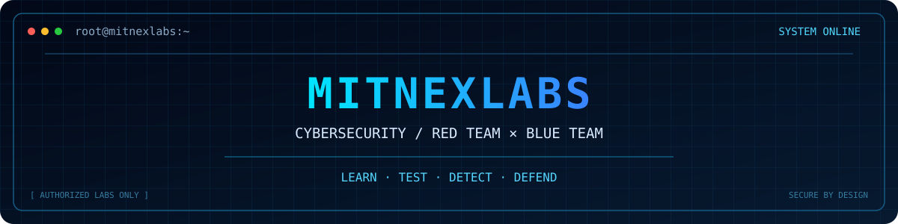

<p align="center">
  
</p>
# `> MITNEX // CYBERSECURITY`

<p align="center">
  
</p>

<p align="center">
  <strong>Cybersecurity Learner · Python · Linux</strong>
  <br />
  Building a foundation in offensive and defensive security.
</p>

<p align="center">
  
  
  
  
</p>

---

## `01 // About Me`

```bash
$ whoami
Cybersecurity learner

$ interests
Offensive Security | Defensive Security

$ tools
Python | Linux

$ mission
Understand threats. Build defenses. Keep learning.
```

I'm building my cybersecurity skills step by step, exploring both how attacks work and how systems can be protected.

- 🔴 Exploring Red Team concepts and ethical penetration testing.
- 🔵 Learning Blue Team fundamentals, threat detection, and incident response.
- 🐍 Practicing Python for scripting and security automation.
- 🐧 Strengthening Linux and command-line fundamentals.
- 🧪 Practicing in authorized labs and CTF environments.
- 📝 Documenting my learning journey and technical notes.

## `02 // Tech Stack`

<p align="center">
  
</p>

| Area | Current focus |
|---|---|
| Programming | Python fundamentals and scripting |
| Operating Systems | Linux and command-line workflows |
| Red Team | Networking, reconnaissance concepts, web security fundamentals |
| Blue Team | Log analysis, threat detection, security monitoring fundamentals |
| Workflow | Git, documentation, reproducible labs |

*These are learning areas, not claims of professional proficiency.*

## `03 // Project Showcase`

<p align="center">
  <i>Building practical skills through documented, hands-on security projects.</i>
</p>

<table>
  <tr>
    <td width="33%" valign="top">
      <h3>⌕ Security Automation</h3>
      <p>Beginner-friendly Python scripts for security-related tasks and automation.</p>
      <p>
        
        
      </p>
    </td>
    <td width="33%" valign="top">
      <h3>▣ Blue Team Log Analyzer</h3>
      <p>A learning project to parse sample logs and identify suspicious patterns.</p>
      <p>
        
        
      </p>
    </td>
    <td width="33%" valign="top">
      <h3>⌘ Cyber Lab Notes</h3>
      <p>Organized notes on Linux, networking, CTF challenges, and security fundamentals.</p>
      <p>
        
        
      </p>
    </td>
  </tr>
</table>

<p align="center">
  <sub>Projects will be linked here as their repositories are created and documented.</sub>
</p>

`CTF` `Writeups` `Security Research`

## `04 // Current Learning Path`

- [ ] Strengthen networking fundamentals: TCP/IP, DNS, HTTP, and ports.
- [ ] Improve Linux and Bash command-line skills.
- [ ] Practice Python scripting and file processing.
- [ ] Study web security in authorized environments.
- [ ] Learn log analysis and basic incident response.
- [ ] Publish my first documented cybersecurity project.
- [ ] Write my first CTF walkthrough.

## `05 // GitHub Activity`

<p align="center">
  
  
</p>

<p align="center">
  
  
  
  
</p>

*Statistics are based on available public repository data and may not reflect all activity.*

## `06 // Connect`

<p align="center">
  <a href="https://github.com/mitnexlabs">
    
  </a>
</p>

---

<p align="center">
  <code>LEARN ETHICALLY · TEST RESPONSIBLY · DEFEND INTELLIGENTLY</code>
</p>

<p align="center">
  <sub>Every expert was once a beginner.</sub>
</p>
