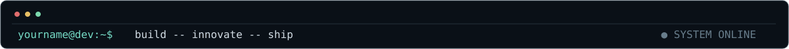
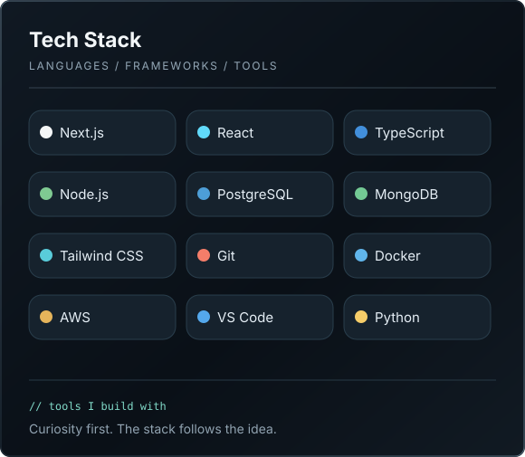
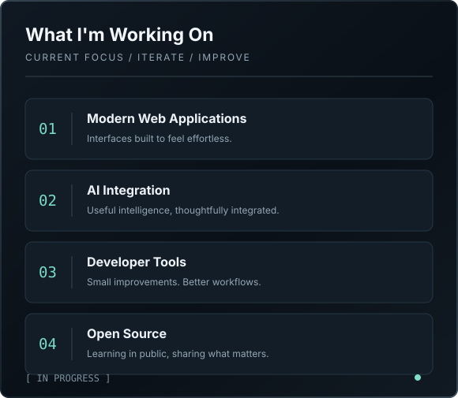
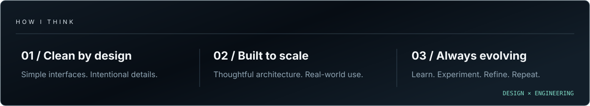

<!--
╔══════════════════════════════════════════════════════════════════╗
║               Mitnex / LABS — PROFILE README                   ║
║  Personalize YOURNAME, yourname@dev and the links below.          ║
║  Edit text inside assets/*.svg to customize visual elements.     ║
║  No GitHub stats, fake metrics, or external image dependencies.   ║
╚══════════════════════════════════════════════════════════════════╝
-->

 

 

<table border="0" cellspacing="0" cellpadding="0">
  <tr>
    <td width="50%" valign="top">
      
    </td>
    <td width="50%" valign="top">
      
    </td>
  </tr>
</table>

 

 

### `LET'S CONNECT`

<!-- Replace YOUR_USERNAME with your real GitHub username. -->

  

<!-- Prefer real work to vanity metrics. Replace the sample technology list with tools you actually use. -->
